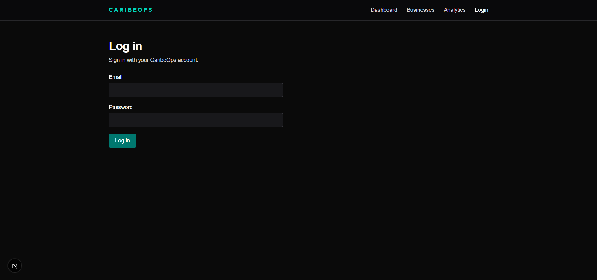
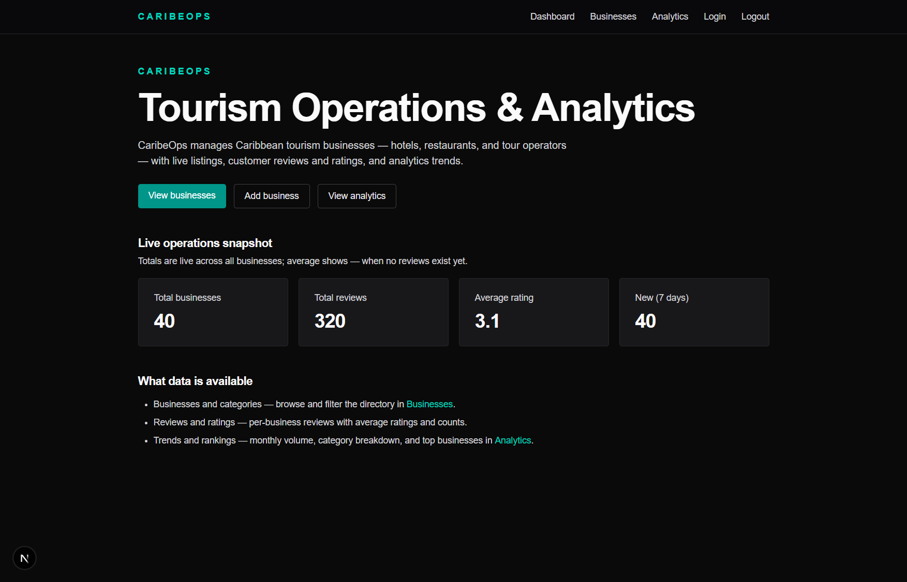
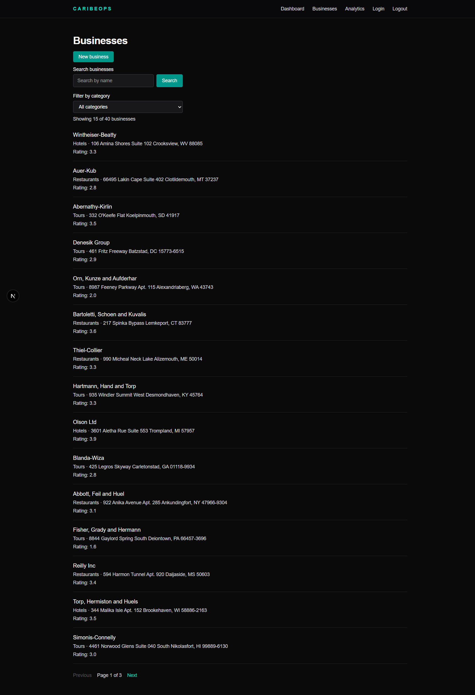
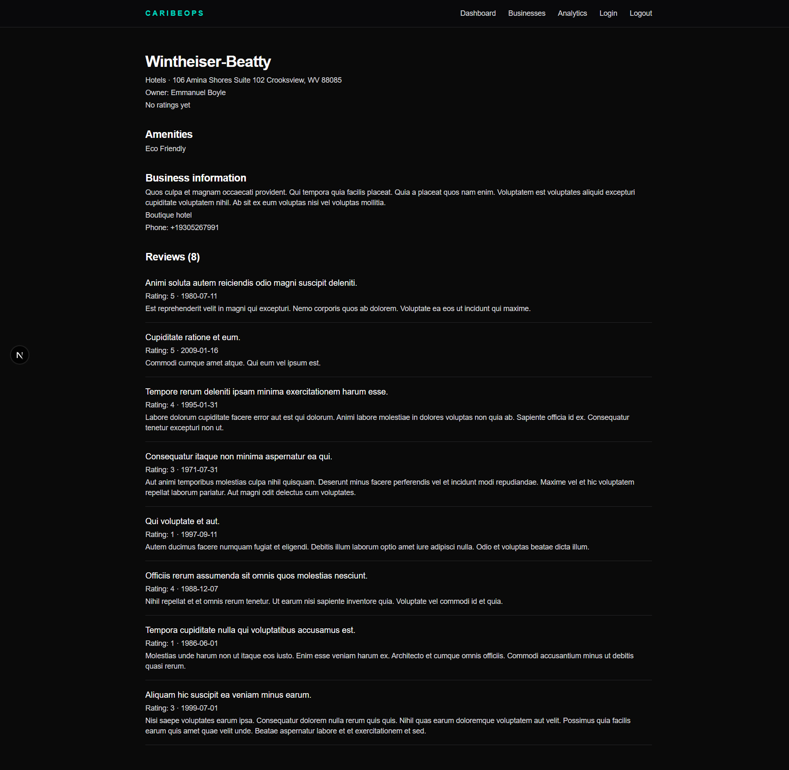
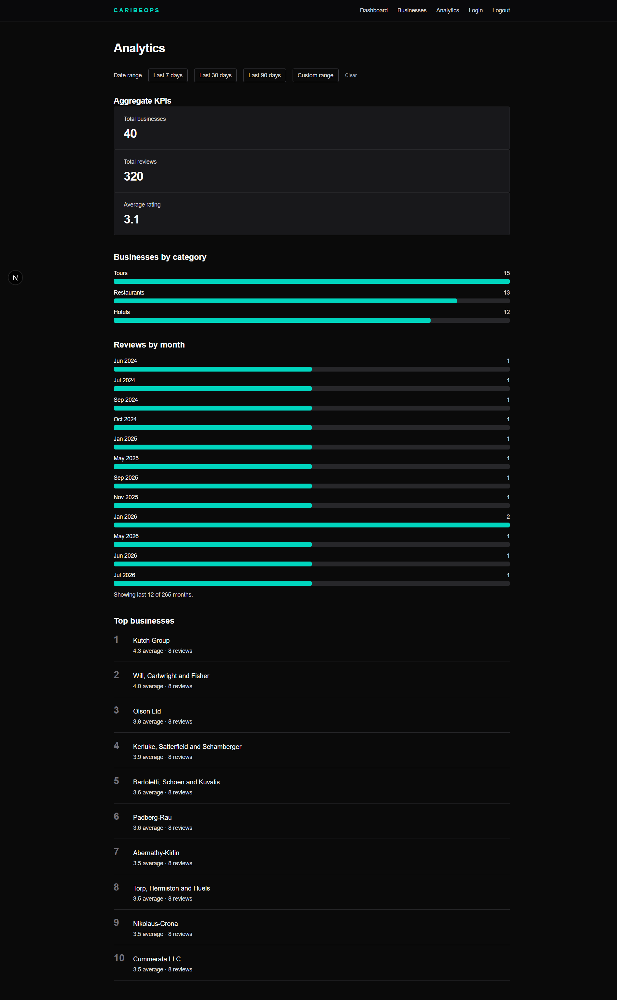

# CaribeOps

Tourism operations and analytics platform for Caribbean businesses — hotels, restaurants, and tour operators — with live listings, customer reviews and ratings, and analytics trends.

## Screenshots

| | |
|---|---|
|  | **Login** — Bearer-token sign-in; anonymous visitors are redirected here. |
|  | **Dashboard** — live operations snapshot: totals from Laravel, KPI aggregates from the Go analytics service. |
|  | **Business list** — searchable, filterable directory with pagination (40 seeded businesses). |
|  | **Business detail** — single business with owner, amenities, and per-business reviews with ratings. |
|  | **Analytics** — aggregate KPIs, businesses-by-category, reviews-by-month, and top businesses. |

Screenshots were captured from the running stack with the seeded demo dataset (3 categories, 40 businesses, 320 reviews). Demo login: `test@example.com` / `password`.

## Tech stack

| Layer | Technology | Responsibility |
|---|---|---|
| Frontend | [Next.js](https://nextjs.org/) (App Router, React 19, TypeScript) | Dashboard, routing, forms, visualization, API consumption |
| Core API | [Laravel](https://laravel.com/) 12 (PHP 8.4) | REST API, business rules, Sanctum authentication, validation |
| Analytics API | [Go](https://go.dev/) | Read-only analytics aggregates for the dashboard |
| Database | [PostgreSQL](https://www.postgresql.org/) 16 | Primary datastore (write via Laravel, read via Go) |
| Orchestration | [Docker Compose](https://docs.docker.com/compose/) | One-command stack: Postgres + Laravel + Go + Next.js |

## Quick start

```bash
git clone https://github.com/LSCAR23/caribeops.git
cd caribeops
cp .env.example .env
cp backend/laravel/.env.example backend/laravel/.env
cp analytics/go/.env.example analytics/go/.env
docker compose up --build
```

Then open [http://localhost:3000](http://localhost:3000) and sign in with `test@example.com` / `password` (seeded demo user).

Full instructions, ports, health checks, and the database-reset gotcha: [docs/setup.md](docs/setup.md).

## Documentation

| Document | Contents |
|---|---|
| [docs/setup.md](docs/setup.md) | Run CaribeOps from a clean checkout |
| [docs/database-reset.md](docs/database-reset.md) | Reset and re-seed the database |
| [docs/deterministic-demo-seed.md](docs/deterministic-demo-seed.md) | Deterministic demo dataset (same data every seed) |
| [docs/api.md](docs/api.md) | REST API reference (13 endpoints) |
| [docs/architecture.md](docs/architecture.md) | System architecture and service responsibilities |
| [docs/database.md](docs/database.md) | Schema, models, and relationships |
| [docs/performance.md](docs/performance.md) | Performance measurements and optimizations |
| [docs/README.md](docs/README.md) | Project overview and 7-day build plan |
